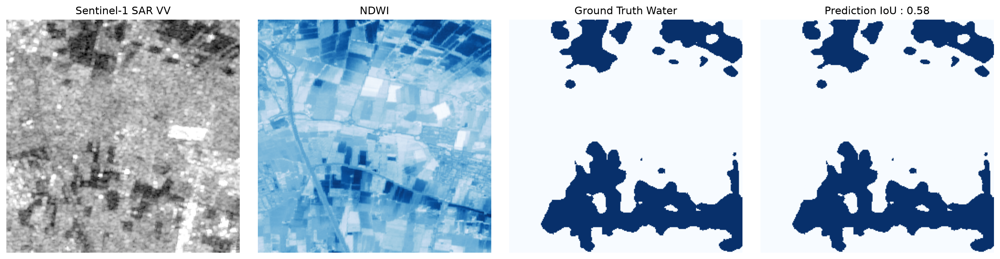

# Automated Multi-Modal Satellite Flood Inundation Segmentation
### Deep Learning Pipeline Fusing Copernicus Sentinel-1 SAR & Sentinel-2 Optical Imagery

This is a deep learning and Earth Observation pipeline designed for automating surface water mapping and flood monitoring.

## Results
The model outputs a binary pixel mask separating standing floodwater from dry land terrain:

## Sensor Fusion and Domain Principles 

During major storm events, conventional optical satellites are obscured by cloud cover. This pipeline implements a multi-sensor fusion strategy:

1. ** Sentinel-1 C_Band: **
    - Microwave pulses that penetrates clouds and rain
    - Very Smooth ,standing water acts as a reflector
2. ** Sentinel -2 MSI : **
    - Near infrared (NIR) light is absorbed by open water wich reflects and appears as dark pixels
    - Computes the ** Normalized difference water index (NDWI) ** to enhance water contrast :
$$\text{NDWI} = \frac{\text{Green} - \text{NIR}}{\text{Green} + \text{NIR}}$$

## Model Architecture and Training Strategy

* **Backbone and Decoder: ** U-Net architecture paired with a ** ResNet -34** encoder
* **Input Dimension:** $4 \times 256 \times 256$ spatial patches.
